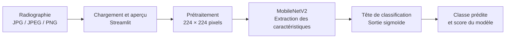

<div align="center">

# 🫁 Classification de radiographies pulmonaires

### Détection expérimentale de la pneumonie avec MobileNetV2

**Deep Learning · Transfer Learning · Application Streamlit**


[Présentation](#présentation) ·
[Fonctionnalités](#fonctionnalités) ·
[Architecture](#architecture-du-modèle) ·
[Résultats](#résultats-expérimentaux) ·
[Auteurs](#auteurs)

</div>

---

> **Projet académique et expérimental.** Cette application n’est pas un dispositif médical et ne doit pas être utilisée pour établir ou exclure un diagnostic. Les scores affichés correspondent aux sorties du modèle.

## Présentation

Ce projet explore la classification automatique de radiographies pulmonaires à l’aide d’un réseau de neurones convolutif.

Le modèle distingue deux classes :

- **NORMAL** : classe des radiographies étiquetées normales dans le dataset.
- **PNEUMONIA** : classe des radiographies étiquetées comme présentant une pneumonie.

La solution utilise **MobileNetV2 pré-entraîné sur ImageNet**, adapté à cette classification binaire par transfert d’apprentissage.

Une application **Streamlit** permet de charger une radiographie, de visualiser l’image et de consulter la prédiction du modèle.

## Contexte académique

| Élément | Description |
|:--|:--|
| Nature | Projet académique de Deep Learning |
| Formation | 5ᵉ année en Ingénierie Informatique et Réseaux |
| Année universitaire | 2025–2026 |
| Domaine | Vision par ordinateur et imagerie médicale |
| Approche | Classification binaire par transfert d’apprentissage |
| Architecture | MobileNetV2 avec tête de classification personnalisée |
| Interface | Application web Streamlit |

## Objectifs

- Préparer un dataset de radiographies pour une tâche de classification.
- Exploiter un réseau pré-entraîné comme extracteur de caractéristiques.
- Construire et entraîner une tête de classification binaire.
- Évaluer le modèle sur un ensemble de test.
- Étudier les courbes d’apprentissage.
- Intégrer le modèle dans une interface web interactive.

## Fonctionnalités

### Chargement des images

- Import d’une radiographie aux formats JPG, JPEG ou PNG.
- Chargement par sélection de fichier ou glisser-déposer.
- Affichage de l’image dans l’interface.

### Classification

- Prétraitement de l’image avant son passage dans le réseau.
- Exécution du modèle entraîné.
- Affichage de la classe prédite.
- Présentation du score associé à la prédiction.
- Représentation visuelle du score dans l’interface.

### Analyse de l’entraînement

- Suivi de l’accuracy sur les ensembles d’entraînement et de validation.
- Suivi de la fonction de perte.
- Évaluation finale sur l’ensemble de test.

## Technologies

| Composant | Technologie |
|:--|:--|
| Langage | Python |
| Deep Learning | TensorFlow et Keras |
| Réseau pré-entraîné | MobileNetV2 |
| Poids initiaux | ImageNet |
| Chargement des données | ImageDataGenerator |
| Interface web | Streamlit |
| Optimisation | Adam |
| Fonction de perte | Binary Cross-Entropy |

## Fonctionnement général



Le projet comprend deux phases :

1. **Entraînement** : préparation des données, construction du réseau, apprentissage et évaluation.
2. **Inférence** : chargement du modèle entraîné et classification d’une image depuis l’application.

## Préparation des données

### Classes

Les données sont organisées autour de deux étiquettes :

```text
NORMAL
PNEUMONIA
```

Des ensembles distincts sont utilisés pour :

- **L’entraînement**, afin d’ajuster les paramètres de la tête de classification.
- **La validation**, afin de suivre le comportement du modèle pendant l’apprentissage.
- **Le test**, afin de mesurer les performances finales sur les données réservées à l’évaluation.

### Paramètres documentés

| Paramètre | Valeur |
|:--|:--|
| Dimensions d’entrée | 224 × 224 pixels |
| Canaux d’entrée du modèle | 3 |
| Taille des lots | 32 |
| Mode des étiquettes | Binaire |
| Mélange des images de test | Désactivé |

Le code de préparation présenté dans le rapport applique une remise à l’échelle des pixels avec `rescale=1./255`.

La transformation utilisée à l’inférence doit rester cohérente avec celle employée lors de l’entraînement du modèle sauvegardé.

### Traçabilité du dataset

La référence exacte du dataset, sa licence et les effectifs par classe et par ensemble restent à préciser pour documenter complètement la reproductibilité de l’expérience.

## Architecture du modèle

### Transfert d’apprentissage

MobileNetV2 est chargé avec les poids ImageNet et sans sa tête de classification d’origine.

Dans la configuration présentée, les couches du réseau pré-entraîné sont **gelées**. L’entraînement porte sur la tête ajoutée pour la classification binaire.

### Tête de classification

```text
Image d’entrée : 224 × 224 × 3
                │
                ▼
MobileNetV2 pré-entraîné sur ImageNet
Couches gelées — include_top=False
                │
                ▼
GlobalAveragePooling2D
                │
                ▼
Dense — 128 neurones — ReLU
                │
                ▼
Dropout — 0,5
                │
                ▼
Dense — 1 neurone — Sigmoid
                │
                ▼
Score de classification binaire
```

Le pooling transforme les cartes de caractéristiques en un vecteur. La couche dense réalise l’adaptation à la tâche, tandis que le dropout introduit une régularisation pendant l’entraînement.

La sortie sigmoïde fournit un score entre 0 et 1. Son interprétation dépend de la correspondance des étiquettes utilisée pendant l’apprentissage.

## Entraînement

| Paramètre | Configuration présentée |
|:--|:--|
| Optimiseur | Adam |
| Taux d’apprentissage | `0.0001` |
| Fonction de perte | `binary_crossentropy` |
| Métrique suivie | Accuracy |
| Nombre d’époques de l’exécution illustrée | 5 |
| Base MobileNetV2 | Gelée |
| Tête de classification | Entraînable |

Les courbes du rapport permettent de suivre :

- L’accuracy d’entraînement et de validation.
- La perte d’entraînement et de validation.
- L’écart entre les performances obtenues sur ces deux ensembles.

## Résultats expérimentaux

L’exécution d’évaluation reproduite dans le rapport donne :

| Mesure sur l’ensemble de test | Résultat |
|:--|--:|
| Accuracy | **82,21 %** |
| Binary Cross-Entropy | **0,4713** |

L’accuracy représente ici la proportion de classifications correctes sur l’ensemble de test utilisé.

Ces résultats décrivent une expérience académique sur un dataset donné. Ils ne constituent pas une validation clinique ni une garantie de performance sur d’autres populations ou conditions d’acquisition.

### Interprétation

- Les courbes montrent une progression des performances pendant l’entraînement.
- Les résultats de validation et de test diffèrent : ils doivent être présentés séparément.
- L’accuracy seule ne permet pas de caractériser les erreurs dans chaque classe.
- Un score élevé sur une image individuelle ne correspond pas nécessairement à une probabilité clinique fiable.

## Application Streamlit

L’interface permet de tester le modèle sans manipuler directement le code d’entraînement.

### Parcours utilisateur

1. Ouvrir l’application.
2. Charger une radiographie.
3. Vérifier l’aperçu de l’image.
4. Consulter la classe prédite.
5. Examiner le score affiché.

Le modèle entraîné et sauvegardé est utilisé pour effectuer les prédictions.

## Limites

- Classification limitée à deux classes.
- Performances dépendantes du dataset et de sa représentativité.
- Sensibilité possible aux différences de qualité et de provenance des images.
- Absence de validation clinique documentée.
- Absence de résultats détaillés par classe dans le rapport.
- Scores du modèle non présentés comme calibrés.
- Provenance exacte et répartition des données à compléter pour la reproductibilité.

## Perspectives d’amélioration

- Documenter précisément le dataset, sa licence et les effectifs.
- Vérifier l’absence de chevauchement des patients entre les ensembles.
- Harmoniser et documenter le prétraitement entre entraînement et inférence.
- Ajouter une matrice de confusion.
- Mesurer la précision, le rappel et le F1-score par classe.
- Étudier la sensibilité et la spécificité.
- Examiner le déséquilibre des classes.
- Comparer plusieurs architectures et stratégies de fine-tuning.
- Évaluer le modèle sur un dataset externe.
- Explorer des visualisations d’explicabilité comme Grad-CAM.
- Versionner les dépendances, les paramètres et les modèles sauvegardés.

Ces éléments constituent des pistes d’évolution et ne sont pas présentés comme des fonctionnalités déjà réalisées.

## Compétences mises en pratique

- Préparation et prétraitement d’images.
- Classification binaire avec un réseau convolutif.
- Transfert d’apprentissage avec MobileNetV2.
- Construction d’une tête de classification avec Keras.
- Entraînement et évaluation avec TensorFlow.
- Lecture des courbes d’apprentissage.
- Intégration d’un modèle dans une application Streamlit.
- Analyse critique des résultats expérimentaux.

## Auteurs

Projet réalisé par :

- **Akram Lemaadni**
- **Said Titi**

Encadré par **Meryem Janati Idrissi**.

Année universitaire **2025–2026**.

[Profil GitHub d’Akram Lemaadni](https://github.com/AkramLemaadni)

---

<div align="center">

**Projet académique de vision par ordinateur avec TensorFlow, Keras et Streamlit.**

</div>
